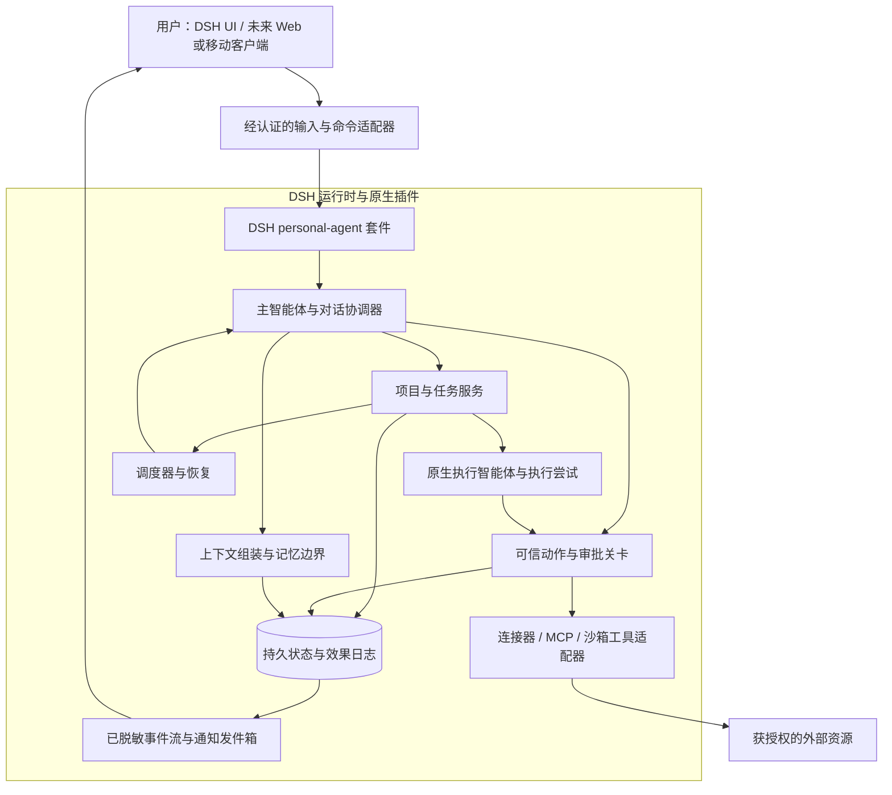

# 01. 产品范围与原生架构

[文档索引](README-zh.md) · [English](01-product-and-architecture.md)

## 1. 产品目标

在 DeepSeek Harness 内构建开源个人智能体，减少用户协调工作的负担。用户应能在后台工作执行期间继续正常对话，询问未完成事项、检查结果、作出决策，并停止或调整工作。

主智能体负责与用户的关系和总体工作队列。执行智能体接收范围明确的任务，并返回证据和产物。它们不会独立拥有用户权限或长期身份。

典型目标：

- “整理这个项目，告诉我阻塞在哪里，并帮助推进下一步。”
- “跟踪这项任务，在我指定的时间提醒我。”
- “找到相关材料并准备草稿。”需要授权时，发送草稿是独立动作。
- “我们已经决定了什么，还有什么未完成，这条事实来自哪里？”
- “停止这项任务。”系统要区分停止请求与已确认的执行终止。

这些是目标行为，并非现有功能声明。

## 2. 产品边界

### 已确认方向

1. **DSH 就是个人智能体。** 不增加拥有用户对话、仅调用 DSH 执行任务的第二个外部推理控制器。
2. **一切皆插件，并具备可强制执行的边界。** 通过 DSH/Cordis 服务和套件组合产品能力。安全检查必须位于可信运行时路径中，而不能仅写在提示词里。
3. **优先支持一个主智能体。** 保持身份和界面简单。除非后续产品决策明确引入多个主智能体，否则额外的专用智能体只是执行细节。
4. **持久化工作不依赖单个 LLM 上下文的存续。** 项目、任务、授权、待答问题和动作回执都需要持久记录。
5. **开放连接器与 MCP。** GitHub 只是一个适配器，不是所有任务的定义。不能强迫个人任务采用拉取请求式记录。
6. **远程/移动端和语音是产品方向。** 它们应连接到同一个智能体和任务模型。具体界面和提供商选择仍需分阶段决定。

### 首个版本的非目标

- 将现有 Bot 绑定为主智能体，或实现独立的不绑定 Bot 替代方案。
- 不经适配就将 Hermes 代码当作 DSH 插件移植。
- 多租户 SaaS、分布式执行集群、自主支付、插件市场或通用工作流语言。
- 承诺完美记忆、外部效果恰好执行一次、零成本主动服务，或兼容所有 MCP 服务器。
- 在证明原生扩展点不足之前修改整个 DSH。

## 3. 架构



图中表示拟议的组合方式，并非现有包名。反向代理、数据库、凭据代理、浏览器进程或语音服务可以独立运行。它们支持 DSH，而不是取代 DSH 的编排角色。

### 职责归属

| 组件 | 负责 | 不负责 |
| --- | --- | --- |
| 主智能体 | 理解意图、提出计划、选择有明确边界的工作、面向用户综合结果 | 自行授予权限或虚构任务完成 |
| 任务服务 | 持久化状态机、依赖、执行尝试、验收证据 | 将 LLM 对话历史作为唯一数据库 |
| 执行适配器 | 将执行尝试映射到原生 DSH 智能体，处理引导、取消、工具/结果事件 | 判定空闲就等于业务成功 |
| 策略/动作关卡 | 已验证身份、范围、当前授权、撤销、动作检查 | 将记忆、外部内容或模型声明当作授权 |
| 上下文/记忆服务 | 在 token 和数据访问预算内提供相关事实与引用 | 存储凭据或替代授权账本 |
| 连接器 | 提供商 API 行为、来源身份、游标、能力、回执 | 因持有访问令牌就推断拥有广泛权限 |
| 客户端适配器 | 认证、呈现、输入、重连、通知展示 | 独立运行一套私有规划和策略逻辑 |

## 4. 拟议的插件与仓库布局

以下名称为本地提案。不要发布这些包，也不要假设上游已存在同名包。

```text
packages/
  personal-agent/       # DSH 套件、配置、服务连接
  core/                 # ID、状态转换、模式、服务契约
  storage-sqlite/       # 迁移、事务、仓储、恢复
  orchestrator/         # 主智能体协调与执行智能体交回结果
  tasks/                # 项目、任务、执行尝试、依赖
  policy/               # 可信动作关卡、授权、审批、审计
  context/              # 有预算限制的上下文组装与来源引用
  scheduler/            # 持久化作业、提醒、唤醒、通知策略
  connectors/           # 注册表与首个提供商适配器
  client-api/           # 范围决定后可选的远程/移动适配器
  voice/                # 范围决定后可选的语音适配器
tests/
  contracts/ integration/ recovery/ security/ fixtures/
docs/
```

建议初期使用 TypeScript/ESM 和单一工作区，但须在 M0 针对固定宿主版本验证。如果减少物理包数量能降低循环依赖，就从更少的包开始；保留服务接口，而不是为每个类制造一个包。

插件契约应声明标识符/版本、支持的宿主版本、依赖、配置模式、能力、生命周期、健康状态、数据迁移归属及关闭行为。缺少必要服务或版本不兼容时，应以易读错误拒绝加载。可选能力应能干净地禁用。

可信进程内插件共享一个运行时信任边界。能力清单不等于操作系统沙箱。不可信执行器或连接器需要独立进程/操作系统身份以及受限 RPC 接口。不要向它们提供用户配置目录、完整凭据环境或不受限制的 shell。

## 5. 原生复用与新增工作

契约匹配时，复用已检查的 DSH 智能体运行时、插件/服务生命周期、提供商/工具集成、会话持久化和子智能体能力。应使用进程内智能体 API，而不是仅为了回调同一宿主，绕经 SDK 子进程进行原生编排。

superagent 原型提供了有价值的设计模式：请求接入、触发器、线程、工单、分配、不可变任务授权快照、持久化效果、发件箱和重启恢复。兼容性验证后再选择性提取或适配。

个人智能体的新增工作包括：

- 以所有者为中心的主对话及跨项目持久化任务模型。
- 已验证的来源/账户身份，以及针对私有数据的动作级授权。
- 持久化审批、问题、撤销及效果结果记录。
- 通用连接器与产物概念，而非单仓库假设。
- 带更正/删除语义且范围受限的个人上下文和记忆。
- 用户可控制的通知/提醒行为，以及后续客户端/语音适配器。

不要复制原型的 `danger-full-access` 等部署假设。不要将其 `src/core/memory.ts` 中的内存仓储实现误认为完整的个人记忆系统。

### 修改核心的规则

先用一个小型、失败的宿主契约测试证明需求。优先使用插件或适配器。确需核心补丁时，记录缺失保证、最小补丁、固定的基线提交、上游策略及兼容性测试。可调查的方向包括持久化远程审批恢复与稳定公共钩子，但这不代表预先认定 DSH 缺乏取消或流式能力。

## 6. 主对话与工作生命周期

执行智能体工作时，主对话保持响应。将用户输入、工作状态和交付状态分开。

1. 认证输入，并根据来源事件去重。
2. 判断是新请求、澄清、已有任务跟进、审批、取消还是普通对话。
3. 仅加载相关项目/任务引用和已获授权的上下文。
4. 派发前持久化任务及所请求的结果。
5. 创建执行尝试，关联原生 DSH 智能体，并执行工具/数据预算限制。
6. 记录有意义的进展、产物、问题和效果。避免输出私有推理或含秘密的原始工具结果。
7. 按任务验收条件验证结果。明确记录完成、失败、取消或不确定状态。
8. 通过持久化发件箱交付结果；除非另有指示，保持原对话目的地。

一个任务可以有多次执行尝试和会话。一个会话可以包含多轮对话。这些标识符和生命周期概念不同。主对话可以压缩上下文或更换运行时智能体，而不丢失未完成工作。

模型生成的交回结果只是提案：任务状态变化仍须通过模式验证、当前版本检查、授权和结果验证。执行智能体不能自行成为主智能体，也不能扩大其他执行智能体的范围。

## 7. 持久化信息与记忆

持续对话已是 DSH 计划中的目标。Hermes 的具体记忆能力仍属于待选项 [O2–O4](04-decisions-and-source-audit-zh.md)；本节提出安全边界，不代表接受其中全部能力。

应分离：

1. **权威工作状态：** 项目、任务、截止日期、下一步、依赖和效果回执。
2. **精简用户资料：** 明确偏好和稳定事实，附来源及有效性信息。
3. **对话/事件记录：** 摘要以及原始消息和产物引用。
4. **检索索引：** 派生视图，可从获授权的来源记录重建。
5. **授权与秘密：** 独立可信存储，绝不从用户资料或摘要推断。

建议初期采用 SQLite，加上可读导出文件及关键词/全文检索。首版不应强制引入向量数据库。在宣称检索质量前，必须测试中文分词、混合语言查询、过时事实替换和访问过滤。

压缩上下文前，持久化结构化检查点：目标、约束、决策、未完成工作、下一步、待审批事项、产物引用和来源指针。重建上下文时，对系统指令、当前请求、任务状态、记忆、近期对话、检索证据和工具输出设置明确预算。不能让检索内容挤掉当前用户消息或安全约束。

记录来源、时间戳、置信度，以及事实是明确陈述还是推断。更正应取代当前事实；删除必须传播到索引和派生摘要。备份需有成文的保留/删除策略。自动事实提取、面向用户的记忆命令及第三方提供商加载是可分别选择的工作包。

## 8. 连接器、MCP 与主动工作

连接器声明所支持的读写操作、账户身份、来源事件 ID、游标语义、速率限制、回执/幂等支持及健康状态。收到的邮件、文档或网页内容是证据，不是所有者发出的指令。

MCP 是一种工具/连接器传输方式。其工具描述和服务器响应不能证明动作安全。在执行边界执行相同的所有者、资源、接收方、数据和授权检查。刷新工具定义不能悄然增加权限。

从一个只读连接器和测试夹具数据开始。审批和效果核对关卡通过后，才增加外部写入。在 M0 选择首个真实提供商；不能仅因为方便，就假设 GitHub 或某个邮箱账户已经授权。

主动候选事项先采用观察模式。确定性的调度器和来源过滤器可以创建候选事项，模型可以估计其价值。实际读写仍须具备相应访问和动作授权。记录通知为何有用，抑制重复通知，遵守免打扰时段，并限制模型/费用预算。用户指定时间的提醒不同于未经请求的建议。

## 9. 服务端、客户端与语音分工

**服务端/原生 DSH 侧：** 权威身份、主智能体、任务状态、权限、连接器凭据、持久事件、调度器和恢复。

**Web/移动端：** 呈现对话/任务/产物；发送经认证命令；展示精确范围的审批；提供取消/调整控件；缓存少量显示状态；从游标恢复；在明确许可下录制/播放音频。绝不能将提供商密钥嵌入移动应用。

**传输建议：** 经认证的 HTTP 命令加 SSE 单向更新，仅在双向或实时媒体需求确有必要时采用 WebSocket/WebRTC。这是拟议契约工作，不代表已有端点。O10 决定统一 API/变更流的详细范围。

**语音方向：** 音频输入 → STT → 同一主智能体命令路径 → TTS 输出。实时语音之后可以共用相同身份和任务会话。O5 决定是否支持可替换提供商。插话应停止播放并请求中断当前模型轮次；停止语音不应隐式取消任务或撤销已提交动作。重大动作仍保留文本确认。手机界面不代表支持 PSTN 电话呼叫。

锁屏推送需要平台服务、令牌、明确许可和交付策略。推送载荷应尽量精简，敏感详情在认证后获取。实时事件流不等于推送通知服务，也不等于交付回执。
