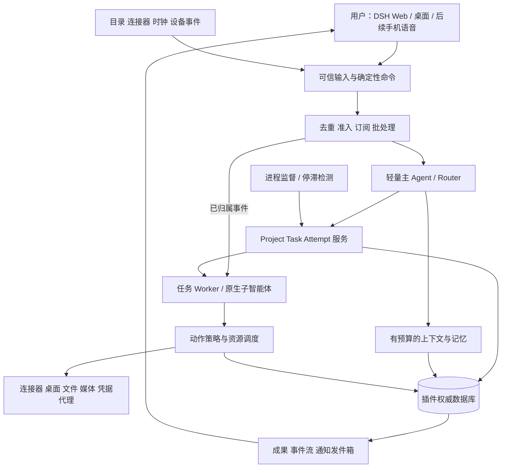

# 01. dshpa 产品目标与系统架构

[文档索引](README-zh.md) · [English](01-product-and-architecture.md)

**DSH Personal Agent，简称 dshpa，是基于 DSH 原生插件的个人工作系统。** 它常驻用户自己的电脑或自有主机，保持一个持续的主对话，理解用户的目标与背景，推进多个任务，操作获授权的工具和电脑，交付可检查、可继续编辑的成果。用户不必管理底层 Session，也不必在每个步骤之间充当调度员。本文是目标设计，未宣称已实现。

## 1. 产品定位与成功标准

核心用户首先是希望管理知识、项目、创作和日常事务的个人，尤其是拥有本机资料、工具链和应用环境的人。产品的价值在于从“我想做什么”持续推进到“成果可用、后续可追踪”。第一版本服务一个 owner/profile；共享给其他人或团队代理不是首版前提。

北极星指标是每周**被用户采纳的成果及节省的干预时间**，同时约束错误外部动作、无效通知和费用。完成数、token 数、运行时长只是诊断数据。首轮试用用实际任务比较人工协调成本，并询问结果是否有用；不凭模型自评声称节省了多少小时。

四个架构目标：

- **连续：** 多轮、跨重启、跨入口理解同一目标；用户补充约束可以影响尚未执行的工作。
- **高产：** 主对话不被一个长任务占用，多个独立任务有明确执行权和成果。
- **主动：** 按明确规则发现变化、提前准备，在值得打扰时带着结果回来。
- **持久：** 任务等待、进程重启和设备离线后可以核对并继续；不以模型上下文存续作为前提。

这些目标承接 Superagent 理念；产品调研、原始来源及实现/愿景的区别见 [05](05-research-and-product-lessons-zh.md)。

## 2. 用户场景和能力阶梯

| 场景 | 用户发起方式 | 完成标准 | 首次交付 |
| --- | --- | --- | --- |
| 项目推进 | “梳理这个项目，找出阻塞并推进下一步” | 有目标、任务、依赖、来源、可审核变更；未完成事项明确 | 基础 alpha |
| 知识与研究 | “结合我的资料研究这个问题” | 引用可打开；事实与推断分开；输出可编辑简报 | 基础 alpha |
| 长期目标/提醒 | “跟踪这件事，周五给我复盘” | 具体成功条件、下一步和显式计划；实际交付可查 | 基础 alpha |
| 电脑协作 | “用本机软件完成这份材料” | 产物保存在指定位置；VNC 实时可见、能接管和停止 | 桌面 alpha |
| 图片/视频创作 | “按参考图做封面和一段短视频” | 可预览文件、版本和编辑清单；说明生成/合成方式 | 桌面 alpha |
| 凭据与账号 | “保存这个账号，以后在这个网站使用” | 专用安全输入、受保护保存、准确站点登录、可锁定/撤销、有使用记录 | 桌面 alpha |
| 个人通信 | “准备会议，整理往来并草拟跟进” | 邮件/日历有来源；草稿与发送分离 | beta |
| 手机/语音/设备 | “在手机上接着处理家里电脑的任务” | 同一权威任务和权限；离线明确等待、恢复不重复动作 | beta / v1 |

能力按可靠性逐级放开：只读理解 → 私有准备 → 本机可逆操作 → 已授权对外动作 → 长期委托。每个能力独立声明访问范围、可执行动作、数据去向和限制；不能用“开启自主模式”一次性覆盖所有操作。

## 3. 产品交互

**主对话**是常驻入口，可以一次提出多个任务、插话、修改方向。开始时简短确认接下来的工作；长任务进入工作队列。**Today** 显示需要用户决定的事项、值得查看的成果和最近截止任务。**项目**显示目标、计划修订、依赖和里程碑。**成果**展示文档、代码、图片、视频、表格及其版本。**连接与设备**显示哪些能力可用、为何在等待。

任务详情提供当前阶段、最近有意义的进展、来源、成果、费用、等待原因及停止/继续/调整按钮。执行细节按需展开；不展示私有推理。运行状态必须区分思考、工具执行、排队、等用户、等环境、恢复和未知结果，不能一直显示泛化的“处理中”。

首次使用不要求填写完整个人画像。选择一个真实任务，确认数据目录、模型配置和必要权限，产生第一个成果后再建议相关连接。没有可访问数据时直报缺失，不生成貌似真实的示例简报。

通知是一项产品成本：一个请求默认只确认一次；正常进展留在工作台；结果、阻塞或必要决定再主动通知。对某个待决事项一次问一个具体问题。用户明确要求的定时提醒独立于建议频控。默认免打扰建议为 22:00–08:00（所选 IANA 时区），用户指定的提醒按原意处理；紧急例外必须由用户定义。

## 4. 逻辑架构与职责



| 组件 | 负责 | 不能承担 |
| --- | --- | --- |
| Router | 理解意图、冷启动任务、跨任务优先级、面向用户综合结果 | 长 shell、深度研究、逐点击操作、每个 worker 的详细计划 |
| Worker | 一个任务的执行、局部拆解、产物与证据；需要时使用 DSH 子智能体 | 自行扩权、成为新的主代理、直接向所有渠道播报 |
| 工作服务 | 任务状态、依赖、等待条件、代次、验收与恢复 | 把模型文本直接当成状态事实 |
| 策略与动作执行 | 确切身份/资源/数据/接收方授权，审阅和回执 | 仅凭提示词、记忆、第三方文档授权 |
| 上下文服务 | 引用召回、分区预算、检查点、事实更正与遗忘 | 把搜索索引当权威数据库，存储秘密 |
| 执行适配器 | 原生 DSH 生命周期、连接器、桌面、媒体、隔离环境 | 重建另一套 LLM 推理循环 |
| UI/客户端 | 输入、呈现、接管、审批、重连 | 保存一套独立规划和权限状态 |
| 监督服务 | 确定性健康与有限恢复，必要时评估停滞 | 自我改写授权、无限重试或提升预算 |

模型负责含糊意图、研究和方案；代码负责身份、唯一性、状态转换、依赖、资源互斥、费用预留和最终派发。模型审核可以补充判断，不能覆盖代码拒绝。普通状态查询、停止、精确审批响应不必调用模型。

## 5. 物理结构：原生套件与独立能力插件

```text
packages/
  personal-agent/       # DSH bundle, core services, consumers and client UI
  plugin-api/           # public versioned service definitions and lifecycle
  plugin-testkit/       # keyless provider contract tests
  memory-sqlite/        # independent default memory provider
  media-comfyui/        # independent default generation provider
  creation-workflows/  # replaceable image and video workflows
examples/plugins/      # custom memory and mock-media examples
tests/ evals/ workflows/ deploy/ docs/
```

这是待创建结构。图片/视频生成、创作流程、记忆后端是独立可替换插件；公开接口、用户配置及迁移规则见 [09](09-plugin-architecture-zh.md)。可信控制代码组合在 DSH/Cordis 内；需要隔离的凭据代理、媒体进程和命令执行器可以有独立二进制/进程，不承担另一套主代理编排。安全拆分按进程/权限决定，不能用目录或 npm 包数量代替。

注册通过 Cordis effect/disposer 管理，声明依赖、配置、健康状态和支持版本。缺失依赖或不兼容应明确失败。配置完整替换规则、启动入口和版本契约遵循固定宿主；只通过命名 `dsh` profile 启动应用。

## 6. 复用与新增边界

| 上游已有 | dshpa 的处理 |
| --- | --- |
| Agent 创建/恢复、steer/inject/cancel、流式和会话日志 | 原生适配；补业务完成、取消核对和客户端投影 |
| 子智能体和 Agent Teams | Worker 内部复用；跨项目长期任务仍由 dshpa 管理 |
| 调度服务 | 复用时间规则和唤醒；补逻辑发生次数去重、授权、业务结果与通知 |
| 通用 SQLite/domain 存储 | 复用经验；因现接口缺跨表事务，产品数据库自有，避免跨库伪原子性 |
| 远程权限/客户端扩展 | 先扩展其资源和视图；不足部分才加 HTTP/SSE |
| CUA/browser providers、SSH、文件沙箱 | 复用驱动；新增共享资源租约、接管与真实隔离验证 |
| credentials 服务 | 复用接口；补安全后端/代理、密码管理 UI 和用途授权 |
| skill、context/compaction | 复用加载和扩展点；新增记忆生命周期、技能评估与版本回退 |
| Superagent Trigger/Thread/Ticket/Assignment、effects/outbox | 选择性适配；替换单仓库身份、全权限、PR 完成与恢复假设 |

所有能力证据见 [04](04-decisions-and-source-audit-zh.md)。不从 prototype 整体 fork 一套旧宿主；先用宿主契约测试验证所需部分。确有扩展缺口，提交最小失败复现、必要保证、补丁范围及上游策略，再修改对应宿主；不能用 SDK 局限推断原生运行时缺能力。

## 7. 持久任务与事件处理

一个用户可见对话可关联多个任务，一个任务可有多个 Attempt 和 Session。Project 可表示有限项目或长期目标；长期目标具有成功条件、检查周期、当前计划版本和里程碑，仍通过相同 Task 执行。Task 保存验收与下一步；Session 仅承载某次上下文。

事件先验证来源身份、去重和过滤。确定性任务引用和订阅命中走快速路径；其余候选批量给 Router。相关但未授权的信息只进入上下文。Worker 遇到超出范围或错误归属时交回，不自行新开更大权限任务。模型提议的计划更新应经版本检查，明确哪些任务被取代、哪些成果可复用。

等待用户、定时事件、设备和资源时持久化条件，释放计算槽；不能通过每分钟询问模型维持“在线”。运行代次防止旧 Worker 写回。任务状态、外部效果、通知交付互相独立；详细契约见 [03](03-contracts-security-and-tests-zh.md)。

## 8. 记忆、知识库与能力积累

持久任务事实、用户明确偏好、对话摘要、外部来源和授权各有独立语义。优先沿稳定对象引用检索，再进行限定范围的全文搜索；向量检索须由质量评测证明必要。上下文按系统约束、当前请求、权威状态、近期对话、相关记忆及检索证据分预算，优先保留当前请求和未解决承诺。

显式记住/查看/更正/遗忘进入基础 alpha。自动提取默认关闭；启用后先生成有来源的候选，并限制敏感信息。更正替代旧事实，删除传播到索引和派生摘要；旧日志不得自动将遗忘内容重新写回记忆。llmwiki 是外部知识来源，默认只读、按配置增量索引；本次指定路径不存在，不自动创建或写回。

重复成功工作可以沉淀成候选 Skill：输入、产出、所需权限、适用条件、实例、测试和版本。通过回放及用户启用后才能使用；技能不能授权自己、安装依赖或创建周期任务。反馈改进提示、流程和检索策略；不把未经验证的“自我进化”作为发布能力。

## 9. 本机、媒体、凭据与未来扩展

本机常驻是默认产品模式，具体架构见 [08](08-local-computer-media-and-vault-zh.md)。主机状态和 GUI/密码库/GPU 可用性独立；后台工作不必依赖打开主界面。ComfyUI 是首个媒体生成适配器候选，FFmpeg 提供确定性视频合成，其他本地/托管后端通过能力接口选择。凭据留在成熟密码库与受保护代理中。

先支持一台权威主机，再增加可选远程执行设备。状态归属不能随设备上线变化；租约过期、断网和跨主机重试必须避免重复执行。云端、手机和语音只是同一系统的部署/入口扩展。语音 STT/TTS 进入相同命令流，插话停止播放不隐式取消业务任务。

## 10. 明确不做与重审条件

首版不做多租户 SaaS、公开插件市场、自研密码库密码学、通用 DAG 工作流语言、自动支付、无约束自改代码或无限模型路由。也不承诺通用 GUI 100% 成功、任意 MCP 安全或睡眠中工作。

只有出现以下证据才扩大架构：单主机吞吐/可用性测量不满足要求→评估分布式；关键词/引用召回质量不足→评估向量；反复同类任务确有独立职责→评估用户可见角色；现有 UI 无法完成具体移动能力→评估原生客户端。路线图中的 beta/v1 能力有任务卡，但不能越过前置验证直接膨胀首版。
