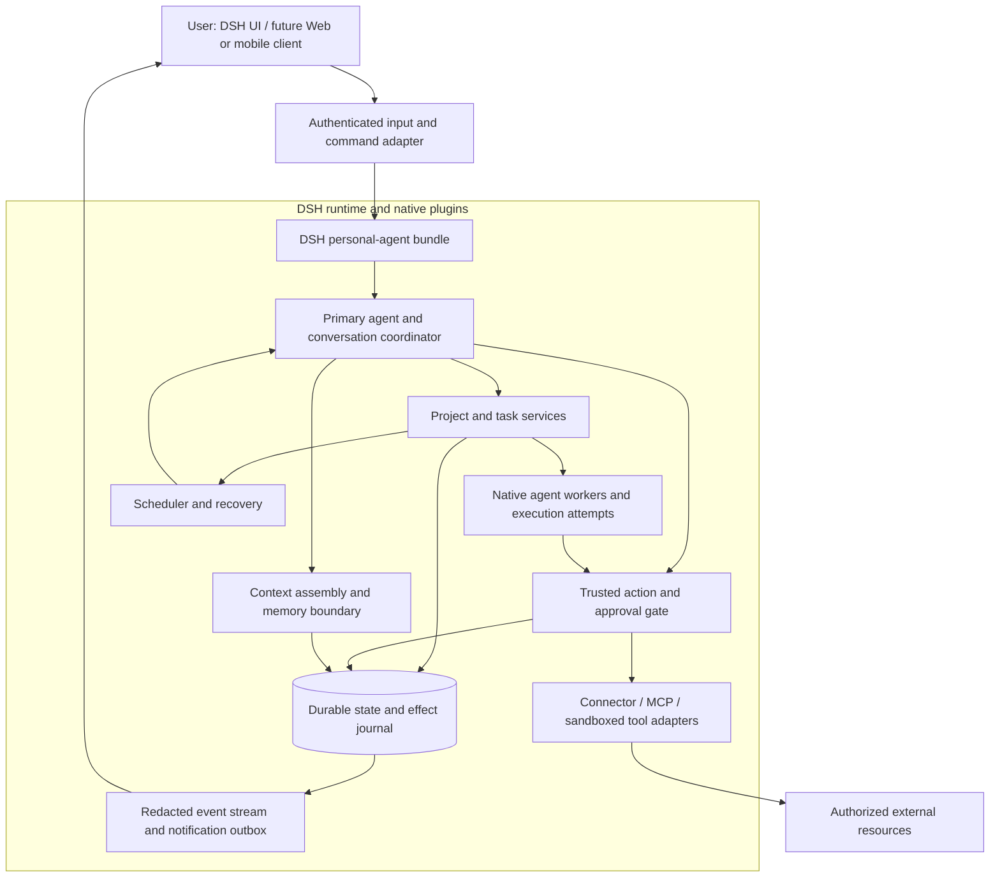

# 01. Product scope and native architecture

[Documentation index](README.md) · [简体中文](01-product-and-architecture-zh.md)

## 1. Product objective

Build an open-source personal agent inside DeepSeek Harness that reduces the user's coordination burden. The user should be able to continue an ordinary conversation while work happens in the background, ask what is unfinished, inspect results, make decisions, and stop or redirect work.

The primary agent owns the relationship and the overall work queue. Workers receive bounded assignments and return evidence and artifacts. They do not become independent owners of the user's permissions or long-term identity.

Representative outcomes:

- “Organize this project, tell me what is blocked, and help with the next step.”
- “Keep track of this task; remind me at the time I choose.”
- “Find the relevant material and prepare a draft.” Sending the draft is a separate action when authorization is needed.
- “What have we decided, what remains, and where did that fact come from?”
- “Stop this task.” The system distinguishes the stop request from confirmed execution termination.

These are target behaviors, not claims of current functionality.

## 2. Product boundaries

### Confirmed direction

1. **DSH is the personal agent.** Do not add a second external reasoning controller that owns the user conversation and calls DSH only for execution.
2. **Everything is a plugin, with enforceable boundaries.** Compose product capabilities through DSH/Cordis services and bundles. Security checks belong in trusted runtime paths, not merely in prompts.
3. **One primary agent first.** Keep identities and UI simple. Additional specialist agents are execution details unless a later product decision explicitly introduces multiple primary agents.
4. **Persistent work outlives an LLM context.** Projects, tasks, authorizations, pending questions, and action receipts need durable records.
5. **Open connectors and MCP.** GitHub is one adapter, not the definition of every task. Personal tasks must not be forced into pull-request-shaped records.
6. **Remote/mobile and voice are product directions.** They should attach to the same agent and task model. Their detailed interface and provider choices remain staged decisions.

### Non-goals for the first release

- Binding an existing Bot as the primary agent, or implementing a separate no-Bot workaround.
- Porting Hermes code as if it were a DSH plugin without adaptation.
- Multi-tenant SaaS, distributed execution fleets, autonomous payments, a plugin marketplace, or a general workflow language.
- Promising perfect memory, exactly-once external effects, zero-cost proactivity, or compatibility with every MCP server.
- Modifying all of DSH before proving that native extension points are insufficient.

## 3. Architecture



The diagram is a proposed composition, not existing package names. A reverse proxy, database, credential broker, browser process, or speech service may run separately. These support DSH; they do not replace it as the orchestrator.

### Ownership of responsibilities

| Component | Owns | Does not own |
| --- | --- | --- |
| Primary agent | Understanding intent, proposing plans, choosing bounded work, user-facing synthesis | Granting itself permissions or fabricating task completion |
| Task service | Durable state machine, dependencies, attempts, acceptance evidence | LLM conversation history as its sole database |
| Execution adapter | Mapping attempts to native DSH agents, steering, cancel, tool/result events | Deciding that idle means business success |
| Policy/action gate | Verified identity, scope, current grants, revocation, action checks | Treating memory, external content, or a model assertion as authorization |
| Context/memory service | Relevant facts and references under a token/data-access budget | Credential storage or a replacement for the grant ledger |
| Connectors | Provider API behavior, source identity, cursors, capabilities, receipts | Inferring broad authority from possession of an access token |
| Client adapters | Authentication, rendering, input, reconnect, notification presentation | Running a separate private copy of the planning and policy logic |

## 4. Proposed plugin and repository layout

Names below are local proposals. Do not publish packages or assume these names exist upstream.

```text
packages/
  personal-agent/       # DSH bundle, configuration, service wiring
  core/                 # IDs, state transitions, schemas, service contracts
  storage-sqlite/       # migrations, transactions, repositories, recovery
  orchestrator/         # primary-agent coordination and worker handback
  tasks/                # projects, tasks, attempts, dependencies
  policy/               # trusted action gate, grants, approvals, audit
  context/              # bounded context assembly and source references
  scheduler/            # durable jobs, reminders, wakeups, notification policy
  connectors/           # registry and first provider adapter
  client-api/           # optional remote/mobile adapter, after scope decision
  voice/                # optional voice adapter, after scope decision
tests/
  contracts/ integration/ recovery/ security/ fixtures/
docs/
```

Use TypeScript/ESM and a single workspace initially, subject to M0 verification against the pinned host. Start with fewer physical packages if that reduces cyclic dependencies; preserve service interfaces rather than manufacturing a package for every class.

Plugin contracts should declare identifier/version, supported host versions, dependencies, config schema, capabilities, lifecycle, health, data migration ownership, and shutdown behavior. Reject missing required services and incompatible versions with a readable error. Disable optional capabilities cleanly.

Trusted in-process plugins share a runtime trust boundary. A capability manifest is not an OS sandbox. Untrusted executors or connectors require an isolated process/OS identity and a restricted RPC interface. Do not give them the profile directory, full credential environment, or unrestricted shell.

## 5. Native reuse versus new work

Reuse the inspected DSH agent runtime, plugin/service lifecycle, provider/tool integration, session persistence, and subagent facilities where contracts fit. Use in-process agent APIs rather than routing native orchestration through an SDK subprocess merely to call back into the same host.

The superagent prototype supplies useful design patterns: intake, triggers, threads, tickets, assignments, immutable mandate snapshots, persistent effects, outbox, and restart recovery. Extract or adapt selectively after the compatibility spike.

New personal-agent work includes:

- An owner-centric primary conversation and cross-project durable task model.
- Verified source/account identity and action-level authorization for private data.
- Durable approval, question, revocation, and effect-result records.
- General connector and artifact concepts instead of single-repository assumptions.
- Bounded personal context and memory with correction/deletion semantics.
- User-controlled notification/reminder behavior and later client/speech adapters.

Do not copy prototype deployment assumptions such as `danger-full-access`. Do not mistake its `src/core/memory.ts` in-memory repository implementation for a complete personal memory system.

### Core-change rule

First prove the need using a small failing host-contract test. Prefer a plugin or adapter. If a core patch is necessary, document the missing guarantee, minimal patch, pinned base commit, upstream strategy, and compatibility test. Plausible investigation areas include durable remote approval resumption and stable public hooks, but they are not preapproved claims that DSH lacks cancellation or streaming.

## 6. Primary conversation and work lifecycle

The primary conversation remains responsive while workers execute. Keep incoming user messages, work state, and delivery state separate.

1. Authenticate input and deduplicate its source event.
2. Determine whether it is a new request, clarification, existing-task follow-up, approval, cancellation, or ordinary conversation.
3. Load only relevant project/task references and authorized context.
4. Persist a task and its requested outcome before dispatch.
5. Create an execution attempt, associate it with a native DSH agent, and enforce its tool/data budget.
6. Record meaningful progress, artifacts, questions, and effects. Avoid streaming private reasoning or raw secret-bearing tool output.
7. Validate outcome against the task acceptance condition. Record completion, failure, cancellation, or uncertainty explicitly.
8. Deliver the result through a durable outbox, preserving the original conversation unless directed otherwise.

A task may have multiple attempts and sessions. One session may contain multiple conversational turns. These are different identifiers and lifecycle concepts. A primary conversation can be compacted or its runtime agent replaced without losing open work.

A model-generated handback is a proposal: task state changes still pass schema validation, current-version checks, authorization, and result validation. A worker cannot make itself the primary agent or expand another worker's scope.

## 7. Persistent information and memory

Continuous conversation is a goal already present in the DSH plan. The specific Hermes memory features remain pending options [O2–O4](04-decisions-and-source-audit.md); this section proposes a safe boundary, not acceptance of all those features.

Separate:

1. **Canonical work state:** projects, tasks, deadlines, next actions, dependencies, and effect receipts.
2. **Compact profile:** explicit preferences and stable facts, with source and validity information.
3. **Conversation/episode records:** summaries and references to original messages and artifacts.
4. **Retrieval index:** a derived view, rebuildable from authorized source records.
5. **Authorization and secrets:** independent trusted storage, never inferred from a profile or summary.

Recommended initial storage is SQLite plus readable export files and keyword/full-text retrieval. Do not require a vector database for the first release. Chinese segmentation, mixed-language queries, stale fact replacement, and access filtering must be tested before making retrieval-quality claims.

Before compaction, persist a structured checkpoint: objective, constraints, decisions, open work, next step, pending approvals, artifact references, and source pointers. Rebuild the context under explicit budgets for system instructions, current request, task state, memory, recent turns, retrieved evidence, and tool output. Do not let retrieval crowd out the current user message or safety constraints.

Record provenance, timestamps, confidence, and whether a fact was explicit or inferred. Corrections supersede current facts; deletions must propagate to indexes and derived summaries. Backups need a documented retention/deletion policy. Automatic fact extraction, user-facing memory commands, and third-party provider loading are separately selectable work packages.

## 8. Connectors, MCP, and proactive work

A connector advertises supported read/write operations, account identity, source event IDs, cursor semantics, rate limits, receipt/idempotency support, and health. Incoming email, documents, or web content are evidence, not instructions from the owner.

MCP is one tool/connector transport. Its tool descriptions and server responses do not prove an action is safe. Apply the same owner, resource, recipient, data, and grant checks at the execution boundary. Refreshing tool definitions cannot silently add permissions.

Begin with one read-only connector and fixture data. Add external writes only after the approval and effect-reconciliation gates pass. Select the first real provider during M0; do not assume GitHub or a particular email account is authorized merely because it is convenient.

For proactive candidates, begin in observe mode. A deterministic scheduler and source filter may create a candidate; the model may estimate usefulness. Actual reading/writing still requires the corresponding access and action grant. Record why a notification was useful, suppress duplicates, honor quiet hours, and cap model/cost budgets. A reminder requested for a time is different from an unsolicited suggestion.

## 9. Server, client, and voice division

**Server/native DSH side:** authoritative identity, primary agent, task state, permissions, connector credentials, durable events, scheduler, and recovery.

**Web/mobile side:** render conversation/tasks/artifacts; send authenticated commands; display approvals with exact scope; provide cancel/redirect controls; cache limited display state; resume from a cursor; capture/play audio with explicit permission. Never embed provider keys in a mobile app.

**Transport recommendation:** authenticated HTTP commands plus SSE for one-way updates, with WebSocket/WebRTC only when bidirectional or real-time media needs justify them. This is proposed contract work, not a claim of an existing endpoint. O10 controls the detailed unified API/changefeed scope.

**Voice direction:** audio input → STT → the same primary-agent command path → TTS output. Real-time speech can later share the same identity and task session. O5 controls interchangeable providers. Barge-in should stop playback and request a model-turn interruption; stopping speech must not implicitly cancel a task or revoke a committed action. Text confirmation remains available for consequential actions. A phone UI is not evidence of PSTN calling support.

Lock-screen push requires platform services, tokens, explicit permission, and delivery policy. Keep payloads minimal and fetch sensitive detail after authentication. A live event stream is not a push-notification service or a delivery receipt.
