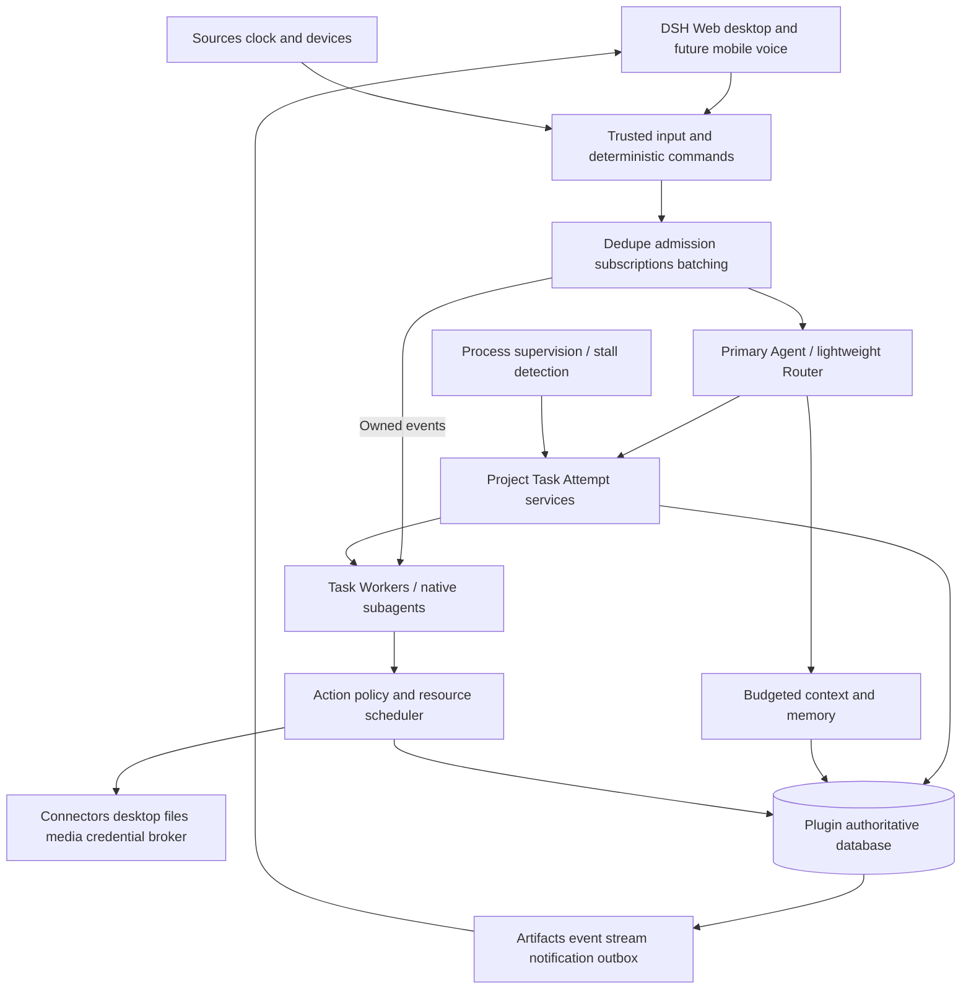

# 01. dshpa product and architecture

[Documentation index](README.md) · [简体中文](01-product-and-architecture-zh.md)

**DSH Personal Agent, or dshpa, is a personal work system built as native DSH plugins.** It resides on an owner's computer or host, maintains a continuous primary conversation, understands goals and context, progresses independent tasks, operates authorized tools and computers, and delivers inspectable, editable outcomes. Users should not manage underlying Sessions or coordinate every step. This is a target design, not an implementation claim.

## 1. Position and success

Start with individuals managing knowledge, projects, creative work and personal affairs, especially those with local data, applications and toolchains. Progress from intent to usable results and tracked follow-through. One owner/profile comes first; shared agents and multi-tenancy are not prerequisites.

The north-star measures are weekly **accepted outcomes and reduced intervention time**, constrained by unwanted effects, interruptions and spending. Task counts, tokens and runtime are diagnostic. Compare actual coordination effort during trials and ask whether outcomes were useful; do not invent hours saved from model self-assessment.

Four architectural objectives:

- **Continuous:** preserve goals across turns, restarts and entry points; apply new constraints to pending work.
- **Productive:** independent execution and outcomes without blocking the primary conversation.
- **Proactive:** prepare useful work under explicit rules and surface meaningful changes.
- **Persistent:** reconcile and resume after waits, restarts and offline devices without depending on one context window.

See [05](05-research-and-product-lessons.md) for Superagent principles, research and evidence boundaries.

## 2. User journeys and capability progression

| Journey | Request | Completion | First release |
| --- | --- | --- | --- |
| Project progress | Find blockers and advance this project | Goals, dependencies, sources, reviewable changes and remaining work | Foundation alpha |
| Knowledge/research | Research using my material | Inspectable citations, facts versus inference, editable brief | Foundation alpha |
| Goals/reminders | Track this and review Friday | Success criteria, next action, explicit schedule and delivery evidence | Foundation alpha |
| Computer collaboration | Complete this using local software | Saved output, live VNC viewing, takeover and stop | Desktop alpha |
| Image/video | Make a cover and short video | Preview, versions and edit manifest; generation/composition labeled | Desktop alpha |
| Credentials | Save this account and use it on this site | Secure input, protected storage, exact-site login, locking/revocation and usage history | Desktop alpha |
| Communication | Prepare a meeting and draft follow-up | Sourced mail/calendar context; drafts separate from sending | Beta |
| Mobile/voice/devices | Continue work on my home computer from my phone | Same task/authority; explicit offline waits and safe recovery | Beta / v1 |

Progress from reading, to private preparation, reversible local operation, authorized external action and ongoing delegation. Each capability declares access, actions, data destinations and limitations. A single autonomy switch cannot cover every operation.

## 3. Interaction

The **primary conversation** accepts multiple tasks, interruptions and changed direction. A concise acknowledgment precedes background dispatch. **Today** prioritizes decisions, usable results and deadlines. **Projects** show goals, plan revisions, dependencies and milestones. **Artifacts** contain versioned documents, code, images, video and data. **Connections/devices** explain availability and waits.

Task detail shows stage, meaningful progress, sources, artifacts, cost and controls. Execution detail is expandable; private reasoning is not displayed. Distinguish thinking, tool execution, queued work, waiting for a person/environment, recovery and uncertain results.

Onboarding starts with one real task and its data/model/permission needs, not a complete personal questionnaire. Missing sources are explicitly unavailable, never replaced by realistic-looking sample briefings.

A request receives one acknowledgment by default. Routine progress stays in the workspace; notify for outcomes, blockers and necessary decisions. Ask one concrete question for a pending decision. Explicit reminders have separate frequency rules. Suggested quiet hours are 22:00–08:00 in the selected IANA zone; explicit reminder timing and user-defined urgent exceptions retain their intended meaning.

## 4. Logical architecture



| Component | Owns | Must not own |
| --- | --- | --- |
| Router | Intent, new-task dispatch, cross-task priority and user synthesis | Long shell/browser/research loops or every worker's detailed plan |
| Worker | Task execution, local decomposition, artifacts and evidence; native subagents when useful | Self-granted authority, new primary identity or independent channel broadcasts |
| Work service | States, dependencies, waits, generations, acceptance and recovery | Treating model prose as state facts |
| Policy/action dispatch | Exact identity/resource/data/recipient authority, review and receipts | Authority inferred from memory or external content |
| Context | Reference recall, budgets, checkpoints, correction and forgetting | Secrets or a search index as canonical state |
| Execution adapters | Native DSH lifecycle and external capabilities | Another LLM runtime |
| Clients | Input, display, takeover, approvals and reconnect | Independent planning or authorization state |
| Supervision | Health and bounded recovery; selective semantic stall checks | Changing its own permissions or spending limits |

Models handle ambiguous intent, research and proposals. Code owns identity, uniqueness, transitions, dependencies, leases, budget reservation and final dispatch. Model review cannot override deterministic denial. Status, stop and exact approval responses need not call a model.

## 5. Physical organization

```text
packages/
  personal-agent/       # DSH bundle, core services, consumers and client UI
  plugin-api/           # public versioned service definitions and lifecycle
  plugin-testkit/       # keyless provider contract tests
  memory-sqlite/        # independent default memory provider
  media-comfyui/        # independent default generation provider
  creation-workflows/  # replaceable image and video workflows
examples/plugins/      # custom memory and mock-media examples
tests/ evals/ workflows/ deploy/ docs/
```

These paths are planned. Media generation, creation workflows and memory are independent replaceable plugins; [09](09-plugin-architecture.md) specifies public contracts, settings and migration. Trusted control services compose inside DSH/Cordis. Credential brokers, media processes and confined executors may be separate processes without becoming independent planners. Package boundaries are not security boundaries.

Use effect/disposer registration, declared services, validated configuration, health and version compatibility. Fail clearly on missing dependencies. Follow pinned host composition and whole-config replacement rules. Applications launch only through named `dsh` profiles.

## 6. Reuse and new responsibilities

| Existing upstream surface | dshpa work |
| --- | --- |
| Agent lifecycle, steer/inject/cancel, streaming, sessions | Native adapter plus business completion, cancellation reconciliation and client projection |
| Subagents and Agent Teams | Reuse inside workers; own cross-project persistent tasks |
| Schedules | Reuse timing and wakeups; add occurrence dedupe, grants, results and delivery |
| SQLite/domain storage | Plugin-owned transactional DB because the audited API lacks cross-table transactions |
| Remote access/client extension points | Extend resources/views first; add HTTP/SSE only for demonstrated gaps |
| CUA/browser providers, SSH, filesystem sandbox | Reuse drivers; add shared resource leases, takeover and verified isolation |
| Credentials | Reuse seam; add protected provider/broker, vault UI and purpose grants |
| Skills and context/compaction | Reuse loading/hooks; add memory lifecycle and evaluated skill versions |
| Superagent intake/tickets/assignments/effects/outbox | Selectively adapt; replace single-repo, full-access, completion and recovery assumptions |

[04](04-decisions-and-source-audit.md) owns evidence. Do not fork the entire prototype with its older host. Prove missing host behavior with a contract test before proposing a minimal patch and upstream strategy. SDK limitations do not establish missing native capabilities.

## 7. Durable work and events

One visible conversation can contain several tasks; a task can have several Attempts and Sessions. Project can represent a finite project or ongoing goal with success criteria, review cadence, plan revision and milestones. Both use the same Task execution model. Sessions carry context, not business ownership.

Authenticate, deduplicate and filter events. Exact task references and subscriptions take the fast path; batch remaining candidates for the Router. Context-only sources confer no authority. Workers hand back out-of-scope or misrouted work. Plan changes compare revisions and identify superseded tasks and reusable artifacts.

Persist wait conditions for people, time, devices and resources, releasing compute slots. Do not maintain presence by repeatedly polling a model. Generations fence stale results. Task state, effects and delivery remain distinct; [03](03-contracts-security-and-tests.md) defines the contracts.

## 8. Memory, knowledge and learned capabilities

Work facts, explicit preferences, conversation summaries, source material and authority have distinct semantics. Follow stable references before bounded text retrieval. Add vectors only for a measured quality gap. Budget system constraints, current request, authoritative state, recent conversation, memory and retrieved evidence; preserve current instructions and commitments first.

Explicit remember/inspect/correct/forget ships in foundation alpha. Automatic extraction is off initially; enabled extraction creates sourced candidates with sensitive-data limits. Corrections supersede facts; forgetting invalidates derived retrieval and prevents silent re-ingestion from old logs. llmwiki is a configured read-only source; its currently missing path must not be created or written implicitly.

Repeated accepted work may produce a versioned candidate Skill containing input/output, capabilities, preconditions, examples and tests. Replay and user activation precede use. Skills cannot grant permissions, install dependencies or schedule themselves. Feedback may improve prompts and retrieval, but unverified self-evolution is not a release claim.

## 9. Local operation and future extension

Resident local operation is the default; [08](08-local-computer-media-and-vault.md) specifies desktop, media and credentials. Host, GUI, vault and GPU availability are independent. ComfyUI is the first generation adapter; FFmpeg supplies deterministic composition; other backends follow capabilities and policy. Credentials remain in mature vaults and protected brokers.

Begin with one authoritative host, then add optional execution devices. Authority does not migrate implicitly with device connectivity. Leases and reconciliation prevent duplicate work. Cloud, mobile and voice extend the same system. STT/TTS uses the existing command path; interrupting playback does not cancel a task implicitly.

## 10. Non-goals and reconsideration triggers

The first release excludes multi-tenant SaaS, a public marketplace, custom vault cryptography, a general workflow language, automatic payments, unconstrained self-modification and unlimited model routing. It does not promise perfect GUI reliability, arbitrary MCP safety or execution during sleep.

Reconsider distribution only after measured single-host limits; vectors after recall failures; visible specialists after repeated role-specific needs; native mobile after a concrete Web limitation. Beta/v1 cards preserve future scope without bypassing initial validation.

Model routing and API gateways are independent plugins too. [10](10-model-routing-and-gateway.md) specifies difficulty/effort selection, user pools, quota fallbacks and DSH request boundaries.
