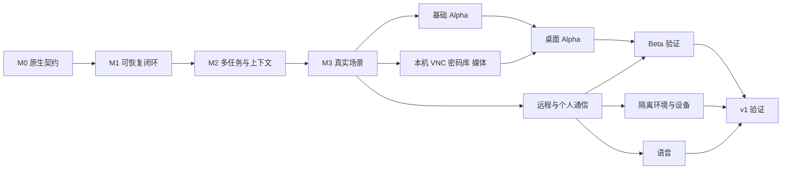

# 02. 实施路线图

[文档索引](README-zh.md) · [English](02-implementation-roadmap.md)

修订：2026-11-07-r7。所有工作仍为计划，尚未实现。本轮将旧版 M0.1 等概略条目替换为稳定的 PA-001–PA-043 任务卡；[机器可读清单](implementation-tasks.json)是依赖、文件范围、步骤及验证命令的唯一任务明细来源。[06](06-agent-execution-guide-zh.md)规定 agent 执行流程，[07](07-evaluation-and-release-gates-zh.md)定义 E00–E24 验收。

## 1. 发布路径与范围

| 阶段 | 用户得到什么 | 必需任务 | 放行条件 |
| --- | --- | --- | --- |
| M0 宿主验证 | 可加载的原生套件和真实宿主契约证据 | PA-001–002 | E00；无未解释的 API 假设 |
| M1 本地闭环 | 主对话提交任务、检查结果、审批和取消；重启后仍可继续 | PA-003–009、PA-038 | 本地产物纵向演示；关键取消/崩溃测试 |
| M2 连续个人助理 | 多任务不堵塞对话、目标/项目、引用召回、显式记忆、费用及注意力控制 | PA-010–014 | E02–E04、E09；不能靠把整段历史塞入提示词实现 |
| M3 真实价值 | 本地知识库、一个 GitHub 连接器、可靠提醒、有限主动准备、经审核技能、常驻运行 | PA-015–021 | E05–E12；至少一条真实读写回读路径 |
| M5-alpha | 可安装、可诊断、可恢复的文本 alpha | PA-027–028 | E00–E12 和 7 天真实使用证据 |
| M3-local | 本机电脑操作、VNC、安全输入/密码库、图片/视频创作 | PA-031–034、PA-036–037、PA-039–043 | E14、E16–E24 |
| M5-desktop-alpha | 首个完整本机常驻产品 | PA-035 | 基础 alpha + 本机能力，7 天实测 |
| M4-beta | 同一个 agent 的移动 Web，以及邮件/日历/消息场景 | PA-022–023 | E13 和真实账户场景 |
| M5-beta | 远程个人助理 beta | PA-029 | 桌面 alpha 回归、远程权限测试、7 天常驻试用 |
| M4-v1 | 隔离/托管环境扩展、自有设备接入、语音 | PA-024–026 | E14–E15，设备离线/恢复、接管和语音歧义测试 |
| M5-v1 | 完整长期运行版本 | PA-030 | 全部场景及 14 天跨设备试用 |

M5 是每个发布级别的验证活动。基础 alpha 验证底座，桌面 alpha 是默认首个完整产品目标，包含 VNC、安全输入和媒体，不必等待跨设备或语音。编号表示阶段类别；实际执行顺序由依赖 DAG 决定。交付“整个计划”不等于现在实施这 43 个任务。

## 2. 明确的默认选择

这些是可修改的**工程基线**，不是已经连接账户或批准模型支出的记录。它们替代旧版“所有细节都待选择”的状态，使 agent 能开始实现。

| 事项 | 默认方案 | 何时重审 |
| --- | --- | --- |
| 运行时 | 指定 DSH 提交，Node >=24.9.0，pnpm 11.28.5；先验证一个受支持本地平台 | PA-001/002 发现不兼容时 |
| 产品宿主 | 一个 owner/profile；先用 DSH Web UI 和一个原生套件 | 多所有者隔离确有需求时 |
| 部署 | 本机常驻是默认产品模式；云服务可选；休眠/锁屏按能力等待与恢复 | PA-021 实测部署能力 |
| 持久化 | 插件专用 SQLite，DSH 保留会话；迁移和动作日志由本项目拥有 | 明确需要多写者或高可用时 |
| 初始连接 | 配置化只读本地目录 + 一个用户指定 GitHub 仓库 | 用户实际工作主要在其他服务时，仅替换适配器 |
| 首条写入 | 测试仓库的 draft PR，准备→审阅→执行→回读 | 真实验收提供具体账号/范围后 |
| UI | 主对话、Today 待决事项、项目/任务详情、成果；复用 DSH 客户端 | 明确需要原生移动能力时 |
| 记忆 | 可替换 MemoryProvider + 默认 SQLite 插件；显式记忆管理，自动抽取关闭，关键词检索起步 | 离线召回评测证明需要向量或自动抽取时 |
| 模型 | 固定/自动模式；用户定义模型池、effort 映射、有序兜底；按权限和预算执行 | PA-040–043；以真实任务评测校准 |
| 主动性 | 默认 off；用户启用具体规则后先 observe，再 prepare | 有价值证据及规则授权后才进入 act |
| 通知 | 结果/问题/阻塞可见；普通进展合并；非请求建议默认每天最多 3 次 | 实测用户采纳率和干扰程度 |
| 费用 | 未配置费用上限时禁止无人值守付费执行；不自动充值或升级 | 所有者明确配置预算后 |
| 知识库 | 仅读取配置且可用的目录；当前 llmwiki 缺失应显示不可用 | 用户提供有效路径时 |
| 许可证 | 保持 Apache-2.0，保留复制代码所需 MIT 声明 | 明确要求变更时 |

待激活时必须提供的信息只有实际账户授权、部署机器、模型/预算、媒体模型、密码库、VNC 服务、远程域名及语音服务；这些不阻碍无凭据开发和夹具测试。不能用假数据把相应实时关卡标成通过。

## 3. 首次纵向演示

场景：用户说“根据这个目录整理项目风险，做一份有出处的简报；再提醒我明天 9 点复查”。

1. 从明确指定目录读取资料，记录来源；不存在则直报不可用。
2. 持久化 Project、Task 和提醒意图；主对话很快恢复可输入。
3. Worker 生成本地简报，包含证据和未解决问题；用户期间能问状态、改变重点。
4. 用户取消第二项准备任务；旧 Worker 不能再写入新结果或产生外部效果。
5. 重启宿主后恢复简报、提醒和取消记录；相同输入不重复建任务。
6. 提醒到期显示交付状态；只有真正产生提醒回执才说已提醒。

M1 先用受控时钟和夹具，M3 再接真实时钟、目录和模型。M1 不能用模拟对话冒充可用产品。

## 4. 里程碑停止条件

- **M0 不通过：** 提交最小失败复现和兼容性决策；保留原版本，不悄然切换旧宿主。
- **授权覆盖不完整：** 禁用缺少执行关卡的工具路径；继续其余已验证路径。
- **远程动作结果不明：** 停止该操作并核对，不让通用重试器重复发送。
- **真实资源缺失：** 记录 live-not-run；继续独立开发，发布等级停留在已证明范围。
- **产品收益不足：** 若主动工作增加干扰或无效成果，降低规则频率/关闭规则；不以添加通知解释噪声。
- **复杂度失控：** 若开始第二套工作流引擎、复制 DSH 运行时、为每个类建包，回到 ADR 评审。

## 5. 排期与投入

不以未经实测的人日承诺作为计划基础。PA-001/002 完成后，以任务级实际改动、验证和返工时间校准估算。每张任务卡原则上形成一个可独立评审的变更；超过三个不相关行为或一个无法单独证明的复杂变更，应在开始前拆为子任务并更新 DAG。

关键路径是宿主契约→事务与授权→执行与恢复→路由与上下文→真实连接器→验收。UI 可以在接口确定后推进；不应先花主要投入构建仪表盘、多角色头像或模型自动选择。agent 的工作量也受真实账户、运行时间和人工体验验收约束，不能因代码生成快而跳过这些关卡。
