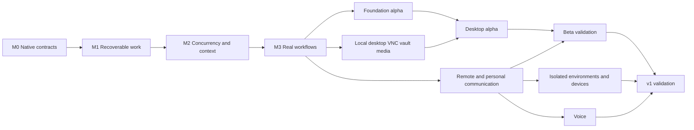

# 02. Implementation roadmap

[Documentation index](README.md) · [简体中文](02-implementation-roadmap-zh.md)

Revision: 2026-11-07-r7. Everything remains planned. Stable PA-001–PA-043 cards replace the older M0.1-style outline. The [machine-readable manifest](implementation-tasks.json) owns detailed dependencies, paths, steps and commands. [06](06-agent-execution-guide.md) defines execution; [07](07-evaluation-and-release-gates.md) defines E00–E24.

## 1. Releases and scope

| Stage | User outcome | Required tasks | Gate |
| --- | --- | --- | --- |
| M0 Host verification | Loadable native bundle and real host evidence | PA-001–002 | E00; no unexplained API assumptions |
| M1 Local loop | Submit, inspect, approve and cancel persistent work; survive restart | PA-003–009, PA-038 | Artifact demo and cancellation/crash tests |
| M2 Continuous assistant | Responsive multi-tasking, goals/projects, recall, explicit memory, cost and attention controls | PA-010–014 | E02–E04, E09; no whole-history prompt workaround |
| M3 Real value | Local knowledge, one GitHub connector, reminders, bounded preparation, reviewed skills, continuous hosting | PA-015–021 | E05–E12 and a real write/readback path |
| M5-alpha | Installable, diagnosable and recoverable text alpha | PA-027–028 | E00–E12 and seven days of real use |
| M3-local | Desktop operation, VNC, secure input/vault and media creation | PA-031–034, PA-036–037, PA-039–043 | E14, E16–E24 |
| M5-desktop-alpha | First complete resident desktop product | PA-035 | Foundation plus local capabilities and seven-day trial |
| M4-beta | Mobile Web access to the same agent and personal communication workflows | PA-022–023 | E13 and live account workflows |
| M5-beta | Remote personal-assistant beta | PA-029 | Desktop-alpha regression, remote access tests, seven-day trial |
| M4-v1 | Additional isolated/hosted environments, personal devices and voice | PA-024–026 | E14–E15, offline recovery, takeover and speech ambiguity |
| M5-v1 | Complete persistent product | PA-030 | All scenarios and fourteen-day cross-device trial |

M5 validates each release tier. Foundation alpha validates the core; desktop alpha is the default first complete product, including VNC, secure input and media, without requiring voice or distributed devices. Stage numbers classify work; the dependency DAG controls actual ordering. Completing this plan does not mean implementing its forty-three tasks now.

## 2. Explicit defaults

These are revisable **engineering defaults**, not account connections or spending authorization. They resolve the earlier open-ended options sufficiently to start implementation.

| Subject | Default | Revisit when |
| --- | --- | --- |
| Runtime | Pinned DSH commit, Node >=24.9.0, pnpm 11.28.5; one verified local platform first | PA-001/002 proves an incompatibility |
| Product host | One owner/profile, DSH Web UI and one native bundle | Multiple owners are a demonstrated need |
| Deployment | Resident local by default; optional cloud services; capability-specific lock/sleep recovery | PA-021 validates deployment; sleeping laptops are not always online |
| Persistence | Plugin-owned SQLite; DSH retains sessions; plugin owns migrations and effects | Multiple writers or HA become necessary |
| Initial sources | Configured read-only local roots plus one owner-selected GitHub repository | Actual workflow favors a different adapter |
| First write | Draft PR in a test repository: prepare, review, execute, read back | Concrete live account and scope are supplied |
| UI | Main conversation, Today decisions, project/task detail and artifacts, reusing DSH | A native mobile requirement is demonstrated |
| Memory | Replaceable MemoryProvider and default SQLite plugin; explicit memory, extraction off, keyword search | Offline evaluation justifies vectors or extraction |
| Models | Fixed/automatic modes, configured pools, effort maps and ordered fallbacks within grants/budgets | PA-040–043; calibrate on real tasks |
| Initiative | Off by default; enable a named rule in observe, then prepare | Proven value and operation grants justify act |
| Notifications | Results/questions/blockers visible; coalesce progress; at most three unsolicited suggestions per day initially | Adoption and interruption evidence suggests adjustment |
| Spending | No unattended paid execution without configured limits; no automatic top-up | Owner configures a budget |
| Knowledge base | Read only configured available roots; missing llmwiki stays unavailable | A valid path is supplied |
| License | Preserve Apache-2.0 and required MIT notices | Explicit licensing instruction |

Actual account authorization, deployment machine, model/budget, media models, vault, VNC server, remote domain and speech provider are activation inputs. They do not block keyless implementation; missing live resources cannot be replaced with fake success.

## 3. First vertical demonstration

Request: “Review project risks from this directory, prepare a sourced brief, and remind me to revisit it tomorrow at 9.”

1. Read the explicitly selected root; report missing material accurately.
2. Persist project, task and reminder intent; keep the conversation usable.
3. Generate a sourced local brief while accepting status questions and changed priorities.
4. Cancel a second preparation task; reject stale worker writes and effects.
5. Restart and recover the brief, reminder and cancellation without duplicate tasks.
6. Show reminder delivery state; claim delivery only with corresponding evidence.

M1 uses controlled time and fixtures. M3 adds real sources, clock and models. Simulated conversation is not a usable-product claim.

## 4. Stop conditions

- **Failed M0:** provide a minimal reproduction and compatibility decision; never silently switch hosts.
- **Incomplete enforcement:** disable the affected path and continue verified paths.
- **Uncertain remote outcome:** reconcile that operation rather than blindly retrying it.
- **Missing live resources:** record live-not-run; continue independent work; limit release claims.
- **Insufficient value:** reduce or disable noisy proactive rules rather than explaining noise with more messages.
- **Growing complexity:** reconsider designs introducing a second workflow engine, copied DSH runtime or per-class packages.

## 5. Scheduling and effort

Calibrate effort from PA-001/002 rather than inventing person-day commitments. Each card should produce one reviewable change. Split unrelated behaviors or changes that cannot be independently demonstrated before starting, and update the DAG.

The critical path is host contracts → transactions/authority → execution/recovery → routing/context → live connector → evaluation. UI work can proceed after interfaces stabilize. Dashboards, avatars and automatic model selection should not consume the initial effort. Agent coding speed does not remove account, elapsed-time or human-experience validation requirements.
