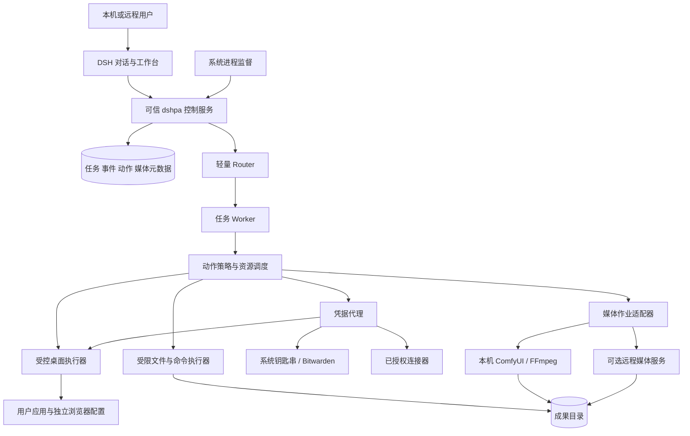

# 08. dshpa 常驻电脑、媒体创作与凭据管理

[文档索引](README-zh.md) · [English](08-local-computer-media-and-vault.md)

本章落实用户补充的明确方向：**dshpa 可以长期运行在用户自己的电脑上；只要必要环境可用，就持续工作、操作电脑、生成图片和视频，并管理及使用本地凭据。** 云服务是可选能力来源，云端协调器不是必需条件。以下为待实施设计。

## 1. 三种部署，统一一个产品

| 模式 | 控制与状态 | 执行环境 | 可用性 |
| --- | --- | --- | --- |
| 本机常驻，默认 | 用户电脑上的 DSH profile、任务数据库、凭据代理 | 本机文件、应用、浏览器、GPU/ComfyUI | 电脑运行且所需服务可用时工作；不要求打开聊天窗口 |
| 自有常开主机 | 用户的 Mac mini、工作站或服务器 | 本机或获授权的其他设备 | 用户负责供电、网络、更新和备份；无 SaaS 依赖要求 |
| 混合，后续 | 一个明确指定的权威主机 | 本机、远程 GPU、受控云环境 | 设备离线只阻塞依赖它的任务；不自动迁移私人数据 |

“在线”需要细分：宿主存活、网络可用、模型可用、桌面已登录/可操作、密码库已解锁、媒体后端可用。仅网络连通不保证所有操作可执行。锁屏时可以继续的 API/文件/GPU 工作与必须等待交互桌面的操作分开调度。睡眠、关机期间不承诺工作；唤醒后核对状态并继续。未配置本地模型时，断网不承诺继续 LLM 推理。

首个桌面验证平台建议 macOS，复用当前 DSH 原生 CUA；Windows/Linux 的桌面操作分别验证后才标为支持。Linux 无桌面服务可以先支持后台任务。安装、登录启动、保持唤醒、授予辅助功能/屏幕录制权限均由安装流程清楚呈现，不自动改系统电源设置。

## 2. 本机架构



同一台物理电脑可以有多个可信度不同的进程。控制服务、授权账本、审计和密码库不能处于任意生成代码可写的目录或安全域。仅把它们放到另一个目录或进程仍不足以隔离同 UID 的任意 shell；按平台验证独立系统身份、沙箱或 VM。不能提供这种保护时，明确限制通用 shell 与密码库同时开放的组合，不宣称已经实现强隔离。

## 3. 电脑操作：优先可靠接口，保留人接管

顺序为：应用 API/连接器 → 语义化浏览器接口 → OS 自动化/可访问性接口 → 屏幕坐标操作。不是每个应用都具备前几种接口；适配器报告能力和降级方式，不能悄然换成更高权限路径。

DSH 的 computer-use registry 只限制 provider 注册，不协调多个 Session 对同一个桌面的操作。因此 dshpa 新增 **整段工作流级桌面租约**：一个共享桌面同时只有一个控制者。文件/API 任务和媒体生成仍可并行；独立浏览器配置可按 provider 实际保证并行。用户接管有最高优先级，释放自动化控制前停止新点击/键盘输入，保留可续接检查点。[固定源码](https://github.com/deepseek-ai/deepseek-harness/blob/fcc0ad462172522aaf5c93a7b2e01f6b9f0b0159/packages/computer-use/computer-use/README.md)。

必需控件：正在操作哪个应用、暂停、立即接管、继续、停止任务。执行前验证当前窗口/页面；导航或焦点变化后重新确认对象。锁屏、权限撤回、登录过期、弹窗遮挡时记录 `waiting_environment`，释放计算槽；不要无限重试。已开始的不可中断操作保持核对状态。

## 4. 图片与视频：后端可替换，创作过程有状态

### 后端选择

| 后端 | 适用 | 成本/限制 | 默认决策 |
| --- | --- | --- | --- |
| 本机 ComfyUI | 可控工作流、已有 GPU/模型、私有素材 | 依赖实际硬件、模型、节点、显存、磁盘 | 首个生成后端，优先连接现有安装 |
| FFmpeg 等确定性工具 | 裁切、字幕、配音混音、图片/片段合成视频 | 不等于生成式视频模型 | 本地合成路径，准确标注能力 |
| 托管图片/视频 API | 本机能力不足，或实测质量更合适 | 外传素材、付费、提供商限制 | 用户允许后启用，不静默回退 |
| 其他本地模型运行器 | 在具体设备上证明更好的质量/速度/维护成本 | 另需适配和验证 | 用同一 MediaProvider 接口扩展 |

没有一个后端在所有硬件、画质和隐私要求下“更好”。用固定样例比较质量、延迟、峰值资源、失败恢复与费用后选择，不在计划里固定尚未测量的模型和显存要求。

ComfyUI 官方提供工作流提交、队列/历史查询与 WebSocket 进度；提交成功返回 `prompt_id`。适配器据此实现异步作业，而不是让 Router 阻塞等待生成。[官方接口](https://docs.comfy.org/development/comfyui-server/comms_routes)。

### MediaProvider 和持久作业

拟议接口：`capabilities()`、`submit(spec, operationId)`、`inspect(handle)`、`cancel(handle)`、`collect(handle)`。每种后端声明取消粒度、幂等能力、结果保留和重连方式。`MediaJob` 保存任务/代次、后端实例、模型与工作流版本、输入哈希、seed、规格、输出句柄、资源租约和状态。不能把某后端支持的能力推定为所有后端都支持。

提交前记意图；收到句柄后持久化；断线后先查队列/历史。提交请求超时且无法找到对应作业时显示 `uncertain`，不自动再生成一遍。进度事件仅用于显示，历史状态及实际输出文件决定完成。完成后验证媒体类型、尺寸、时长和哈希，再登记 Artifact。

ComfyUI 的当前任务中断接口不是天然按 dshpa Task 隔离的取消。共享实例上，只能在确认当前运行作业归属后中断；否则等待或交给用户。默认使用独占 dshpa 实例或后端调度锁；不可为取消一张图而杀掉用户自己的渲染。

首版优先使用审核并固定版本的工作流模板。任意工作流、custom node、模型下载和升级属于软件/资源变更，不能因为来自网页就自动执行。适配器检测缺失组件并给出具体修复项；不在测试时偷偷下载数十 GB 模型。

### 可交付的创作闭环

- **图片：** 需求与参考图 → 参数与输出规格 → 生成 → 预览/选择 → 局部修改或变体 → 保存原图和版本。
- **视频：** 目标、时长、比例 → 分镜 → 素材/镜头生成或选取 → 合成、字幕、音频 → 可播放预览 → 指定镜头重做 → 成片及可编辑清单。
- 保留素材来源、工作流/模型版本、seed 和编辑清单；相同 seed 也不承诺跨硬件逐字节一致。
- 发布到外部平台是单独的受授权动作。生成完成不等于发布完成。

媒体展示需要专用受认证端点和 Range 支持。已审计 DSH 文件路由有整文件返回和大小限制，不能据此承诺大视频流式预览；PA-034 实现限域、限大小、可断点读取的媒体服务。[当前路由说明](https://github.com/deepseek-ai/deepseek-harness/blob/fcc0ad462172522aaf5c93a7b2e01f6b9f0b0159/packages/api/session-controller/README.md)。

## 5. 密码管理：做可信入口与代理

dshpa 的产品目标包括保存/更新登录项、生成密码、查找账号、锁定密码库、在获授权网站登录、管理 API 凭据和显示使用记录。首版复用系统钥匙串与 Bitwarden，不自研加密协议、跨设备密码同步、主密码恢复或浏览器密码管理器。可以在 dshpa 中提供统一入口，秘密仍由成熟后端负责。

模型可见的工具只返回凭据 ID、显示名、允许的来源/目的地、锁定状态和使用结果。建议 `vault.find`、`vault.request_save`、`vault.use`、`vault.lock`；不提供返回明文密码的通用 `vault.get`。保存密码采用受保护表单，生成密码直接写入密码库；用户查看明文走本机 UI 及重新验证身份。

Bitwarden CLI 的账号登录与密码库解锁是两件事；API key 不替代解密所需的解锁。解锁 session key 本身是秘密。`bw serve` 能暴露广泛操作，不能直接作为 agent 的开放 MCP 服务。[Bitwarden 官方 CLI](https://bitwarden.com/help/cli/)。代理仅接受受认证、限定账号/项目/域名/用途/有效期的请求，在自己的受限环境中调用后端并过滤输出。

原生 DSH 已有凭据服务接口，但当前本地文件 provider 可被同 UID 进程读取，OS keychain provider 尚未提供。因此“已有 credentials 服务”不能等同于“已经有适合任意电脑操作 agent 的密码保险箱”。[接口](https://github.com/deepseek-ai/deepseek-harness/blob/fcc0ad462172522aaf5c93a7b2e01f6b9f0b0159/packages/credentials/credentials/README.md)、[本地 provider 限制](https://github.com/deepseek-ai/deepseek-harness/blob/fcc0ad462172522aaf5c93a7b2e01f6b9f0b0159/packages/credentials/credentials-local/README.md)。

### 使用和锁定规则

1. 用户在可信 UI 解锁或授权特定凭据用途；可设置有限时间的重复使用范围，避免每步重复确认。
2. 代理绑定准确站点 origin、账号和任务；重定向、跨域 iframe、账号切换后重新校验。
3. 密码进入受保护登录通道，不进入模型上下文、日志、命令参数、产物、剪贴板或截图。浏览器 DOM、网络日志、可访问性树与错误也需要检查，不能只遮住截图。
4. 已登录 cookie/session 同样具有访问能力；密码不可见不等于登录后的数据不可访问。浏览器配置与操作权限也必须限定。
5. 锁库、超时、重启和授权撤销阻止新使用；暂停相关任务等待用户，允许无关任务继续。主密码、MFA 与恢复操作由用户接管。

对于无人值守工作，优先使用已授权、可撤销的服务令牌或限定会话；不默认永久解锁整个私人密码库。用户自己的电脑提供了部署自由，但不能自动解决任意本地进程读取秘密的问题。

## 6. 安全密码与密钥输入通道（PA-037）

用户明确要求的安全输入机制是桌面 alpha 必需能力，不能以“把密码发给 agent”替代。支持密码、API token、SSH 私钥及其口令等类型；具体后端不支持的类型应在输入前说明。

```text
agent 提出凭据需求（不包含秘密）
  → 可信服务生成 SecretInputRequest
  → 用户端安全表单
  → 认证的 TLS / 受保护本机 IPC
  → 凭据代理 → 系统钥匙串 / Bitwarden / 临时内存租约
  → 不透明 CredentialRef + 保存回执
  → agent 请求按用途使用 → 可信执行器注入登录或 API 通道
```

卡片显示请求任务、准确目标服务/域名、凭据类型、保存后端、用途范围、有效期，以及“仅本次使用 / 保存并授权指定用途”。用户可以取消或选择已有凭据。解锁密码库与保存业务密码是不同操作；不让主密码进入普通输入卡片。

`SecretInputRequest` 绑定可信 owner、设备、任务版本、允许的目的地、过期时间和一次性 nonce。提交端点由宿主固定，不能由模型、网页或 MCP 指定。用户提交原始值直接到代理；消息流只记录请求 ID、成功/失败和引用。重放、错设备、错来源或过期提交拒绝，错误不回显原始值。

安全表单不进入聊天内容、自动截图、模型 DOM/可访问性采集、分析埋点或会话回放。输入期间暂停相关模型屏幕/浏览器采集；恢复前离开敏感界面。密码管理器填充可被支持，但不能把系统剪贴板变成自动中转通道。用户主动查看秘密走受保护 UI，不回传给模型。

网关及代理关闭请求体日志、调试转储和秘密字段错误回显，检查 Origin/CSRF，限制输入大小和类型。前端不把秘密写入 localStorage、URL 或离线缓存；临时状态尽快释放，但不宣称 JavaScript 能可靠擦除所有内存副本。密码库不可用时等待或取消，不降级到明文文件/任务数据库。

代理向可信适配器提供有期限、限用途的机器可用凭据；模型仍只持有引用。授权的登录、API 请求或受限子进程可由代理完成，秘密不成为通用 shell 环境。输入完成不自动扩大任务授权；修改用途另走授权判断。临时租约在锁库、超时、重启或撤销时失效，相关任务转等待。

E20 用专用 canary 密码/密钥验证输入→保存→获授权使用→回执的真实路径，并扫描事件、提示词、日志、产物和错误输出。测试断线、重复提交、保存失败、锁库以及恢复；不能只检查表单使用了 `type=password`。

## 7. 资源调度和新增验收

资源不是只有 Worker 数量。`ResourceLease` 至少覆盖共享桌面、浏览器配置、GPU 实例、重型渲染槽、工作目录和凭据用途。首版 GPU 重任务并发为 1，随后按测量配置；为对话和取消命令保留服务能力。磁盘不足或显存不足先阻止/延迟作业，不能反复重试造成机器不可用。

PA-031–037 是桌面 alpha 的必需路线，不再把本地电脑操作全部推迟到云端或跨设备阶段。E16 验证媒体作业，E17 验证凭据使用，E18 验证常驻电脑真实运行，E19 验证实时桌面，E20 验证安全输入；详见 [07](07-evaluation-and-release-gates-zh.md)。安装实际软件、解锁真实密码库和连接账户属于以后实施时的具体操作，本次没有执行。

## 8. VNC 实时桌面查看与接管

这是用户明确要求的能力，进入桌面 alpha（PA-036）。Dots 官方描述用户可以打开 agent 的电脑查看工作；这是体验参考，不能证明 Dots 内部使用 VNC。本项目明确实现 VNC 接入。

首选浏览器内嵌 noVNC。需要桥接 TCP 时采用独立的 websockify 或经过验证的等价服务；应用授权仍由 dshpa 网关负责。[noVNC 官方介绍](https://novnc.com/info.html)、[websockify 项目](https://github.com/novnc/websockify)。

```text
用户工作台 / 手机浏览器
  → 已认证桌面会话（owner + device + environment + view/control）
  → TLS/WSS 桌面网关 + 短期授权
  → 私有地址的 VNC/RFB 服务
  → 真实桌面，或明确标识的独立虚拟桌面
```

- **真实画面：** 显示目标桌面、当前任务、控制者和连接状态；支持适应窗口、全屏、分辨率变化和移动端查看。截图轮询不能冒充实时桌面。
- **先看再接管：** 默认只读，查看与控制权限独立。不能仅设置客户端 `viewOnly`；服务端必须拒绝未授权键鼠和剪贴板消息。
- **单一控制权：** agent、远程用户和本机用户使用同一仲裁逻辑。接管先阻止新 agent 输入、结算在途输入，再授予用户控制。不能探测本机活动的后端须要求显式暂停并披露限制。
- **交还控制：** 用户点击继续后，agent 重新观察页面和任务版本，再申请租约；不得沿用旧坐标。掉线使远程控制租约过期，默认保持 agent 暂停。
- **会话权限：** 授权绑定环境和设备，不放在可持久记录的 URL 中；检查 Origin、过期和撤销，主动断开失效连接。不可接受任意 host/port 变成内网代理。
- **网络与隐私：** 原始 VNC 仅回环/私网，远程入口用 TLS/WSS；剪贴板、文件传输和录像默认关闭。回环地址不能替代后端认证和进程边界。
- **登录界面：** 用户可在安全接管中操作真实桌面，同时暂停模型截图、DOM/网络采集和录像。普通 VNC 不天然具备按应用视觉隔离能力。

本机 alpha 在认证的本地工作台验证；PA-022 将相同桌面会话扩展到远程设备。嵌入 noVNC 不代表互联网远程访问已经完成。PA-036 验证具体服务器的 macOS 认证、锁屏和会话行为；Windows/Linux 分别验证。固定依赖并保留 noVNC 的 MPL-2.0 和所选桥接器适用声明。

媒体生成和创作工作流均以独立插件交付；用户切换、在途作业绑定和记忆插件规范见 [09](09-plugin-architecture-zh.md)。
