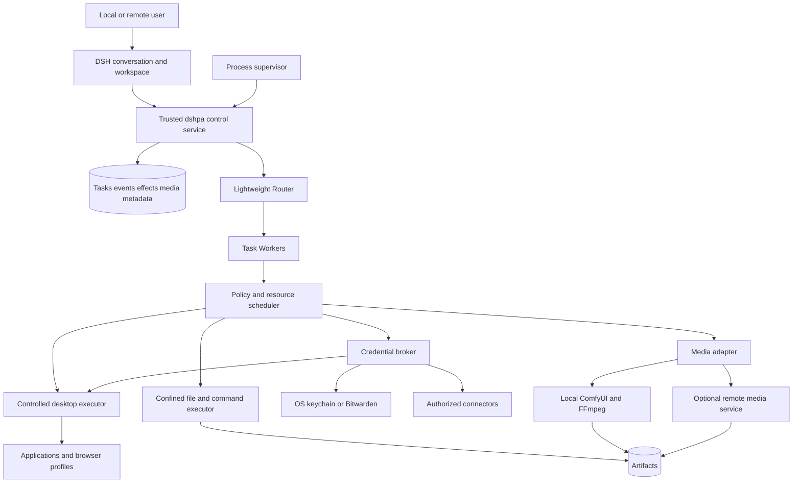

# 08. Resident dshpa, media creation and credentials

[Documentation index](README.md) · [简体中文](08-local-computer-media-and-vault-zh.md)

The explicit product direction is a **dshpa that lives on the user's computer**, continues work while required environments are available, operates applications, produces images/video, and manages and uses credentials. Cloud services are optional providers; a cloud coordinator is not required. This chapter specifies planned behavior.

## 1. Three deployments, one product

| Mode | Control and state | Execution | Availability |
| --- | --- | --- | --- |
| Resident local, default | DSH profile, database and credential broker on the owner's computer | Local files, apps, browser and GPU/ComfyUI | Continues without an open chat window while required services are available |
| Owner-operated always-on host | Personal workstation, Mac mini or server | Local or explicitly connected devices | Owner supplies power, connectivity, updates and backup |
| Hybrid, later | One designated authoritative host | Local devices, remote GPU or controlled cloud environment | Offline devices block dependent work only; no implicit data migration |

Distinguish host, network, model, interactive desktop, unlocked vault and media-backend availability. Network connectivity alone does not make every capability available. API/file/GPU work may continue while interactive desktop work waits. Sleeping or powered-off computers do not execute work; wakeup reconciles state. Without a configured local model, offline LLM reasoning is not promised.

Verify macOS first using the current native DSH CUA. Validate Windows/Linux desktop support separately; headless Linux can support background work. Startup, permissions and power settings must be explicit installation choices.

## 2. Local architecture



One physical machine can contain several trust domains. Arbitrary generated code must not be able to modify control state, audit or vault data. A separate directory or same-UID process is insufficient; validate an OS identity, sandbox or VM boundary. Where that cannot be enforced, restrict combinations of unrestricted shell and vault access and document the limitation.

## 3. Computer operation and takeover

Prefer application APIs/connectors, then semantic browser interfaces, OS accessibility automation, and finally screen coordinates. Report capability limitations and explicit fallback choices.

The DSH computer-use registry selects a provider but does not arbitrate concurrent sessions on a shared desktop. Add a **whole-workflow desktop lease**. One controller owns the desktop; API/file/media work remains concurrent. Independently isolated browser profiles may run concurrently where the provider guarantees it. User takeover stops new automated input and preserves a checkpoint. [Pinned source](https://github.com/deepseek-ai/deepseek-harness/blob/fcc0ad462172522aaf5c93a7b2e01f6b9f0b0159/packages/computer-use/computer-use/README.md).

Required controls show the application in use, pause, takeover, continue and stop. Validate the current window/page and recheck after navigation or focus changes. Locked screens, missing permissions and expired login become `waiting_environment`; release compute rather than retrying indefinitely. Reconcile non-interruptible actions honestly.

## 4. Image and video generation

### Provider selection

| Backend | Suitable use | Tradeoff | Decision |
| --- | --- | --- | --- |
| Local ComfyUI | Existing GPU/models, controlled workflows, private inputs | Hardware, node, memory and storage requirements | First generative adapter; connect an existing installation |
| FFmpeg and deterministic tools | Crop, subtitles, audio mix and image/clip composition | Composition is not generative video | Local fallback with an accurate capability label |
| Hosted media APIs | Insufficient local hardware or better measured quality | Input disclosure, price and provider limits | Opt-in; no silent cloud fallback |
| Other local runners | Demonstrably better on the target device | Additional integration and verification | Same MediaProvider interface |

Choose using fixed samples, quality, latency, peak resources, recoverability and cost. Do not invent universal model or VRAM requirements.

ComfyUI exposes workflow submission, queue/history and WebSocket progress, returning a `prompt_id`. Use an asynchronous adapter rather than holding the Router while rendering. [Official API](https://docs.comfy.org/development/comfyui-server/comms_routes).

### Durable media jobs

Proposed methods: `capabilities()`, `submit(spec, operationId)`, `inspect(handle)`, `cancel(handle)`, `collect(handle)`. Providers declare cancellation granularity, idempotence, retention and reconnect behavior. MediaJob records task/generation, provider instance, workflow/model versions, input digests, seed, specification, output handles and resource leases.

Persist intent before submit and the provider handle afterward. Reconnect through queue/history. A lost submission response without a discoverable matching job becomes uncertain, not an automatic second render. Progress is presentation data; final backend state and verified output files establish completion. Validate MIME, dimensions, duration and hashes.

ComfyUI's current-workflow interrupt is not automatically scoped to a dshpa task. Interrupt only when the running job is demonstrably owned; otherwise wait or hand off. Prefer an exclusive instance or backend scheduling lock. Never cancel another user's render.

Start with reviewed, versioned workflow templates. Custom nodes, model downloads and upgrades are software/resource changes, not automatically trusted content. Report missing components without silently installing large dependencies.

### Creation workflows

- **Image:** brief/reference → output specification → generate → preview/select → edit/variants → original and versioned output.
- **Video:** purpose/duration/aspect → storyboard → selected/generated shots → assembly/subtitles/audio → playable preview → selective regeneration → final file and editable manifest.
- Retain source assets, workflow/model versions and seeds. Seeds do not promise identical bytes across hardware.
- Publishing is a distinct authorized action, separate from generation.

Add authenticated, scoped, range-capable media delivery. The audited DSH file route returns entire files with size restrictions; it does not establish large-video streaming support. PA-034 owns this addition. [Current route](https://github.com/deepseek-ai/deepseek-harness/blob/fcc0ad462172522aaf5c93a7b2e01f6b9f0b0159/packages/api/session-controller/README.md).

## 5. Credential management through a trusted broker

The product includes saving/updating login entries, generating passwords, finding accounts, locking the vault, authorized sign-in, API credential management and usage history. Reuse OS keychain and Bitwarden; do not implement cryptography, vault sync, master-password recovery or a browser password manager from scratch.

Model-visible tools return IDs, labels, allowed destinations, lock state and outcomes. Suggested operations are `vault.find`, `vault.request_save`, `vault.use`, `vault.lock`, with no general plaintext `vault.get`. Secure forms collect secrets; generated passwords go directly to the vault. Human plaintext reveal requires local UI reauthentication.

Bitwarden account login and vault unlock are distinct; API keys do not replace vault decryption, and unlock session keys are secrets. `bw serve` exposes broad CLI capabilities and must not be exposed directly as an agent MCP service. [Official CLI](https://bitwarden.com/help/cli/). The broker authenticates and scopes requests, runs the backend privately and strips secret outputs.

DSH already has a credential service, but its current local file provider is readable by same-UID processes and does not ship an OS keychain provider. This is not yet a protected vault for arbitrary computer-operation agents. [Service](https://github.com/deepseek-ai/deepseek-harness/blob/fcc0ad462172522aaf5c93a7b2e01f6b9f0b0159/packages/credentials/credentials/README.md), [provider limitations](https://github.com/deepseek-ai/deepseek-harness/blob/fcc0ad462172522aaf5c93a7b2e01f6b9f0b0159/packages/credentials/credentials-local/README.md).

### Use and locking

1. Unlock or grant a specific credential purpose through trusted UI. Bounded recurring grants avoid repeated confirmation for identical authorized work.
2. Bind the exact origin, account and task. Recheck redirects, cross-origin frames and account changes.
3. Keep passwords outside model context, logs, arguments, artifacts, clipboard and screenshots. Check DOM, network logs, accessibility trees and errors too.
4. Logged-in cookies are capabilities. Hidden passwords do not eliminate access to authenticated data; scope browser profiles and actions.
5. Lock, expiry, restart and revocation prevent new uses. Dependent tasks wait; unrelated work continues. Master passwords, MFA and recovery require human takeover.

For unattended work prefer revocable service credentials or bounded sessions rather than permanently unlocking the whole personal vault. User-owned hardware does not itself stop arbitrary local processes reading secrets.

## 6. Secure password and key intake (PA-037)

The explicit secure-input requirement is mandatory for desktop alpha. Support passwords, API tokens and SSH private keys/passphrases where the selected backend supports them; disclose limitations before collecting a value.

```text
Agent requests credential metadata
  → trusted SecretInputRequest → secure user form
  → authenticated TLS / protected local IPC
  → broker → keychain / Bitwarden / temporary in-memory lease
  → opaque CredentialRef and sanitized receipt
  → purpose-authorized use by a trusted login/API adapter
```

Show task, exact service/origin, credential type, storage provider, scope, expiry and temporary-versus-saved choice. Allow cancellation or selection of an existing item. Vault unlock is separate; master passwords do not enter the ordinary credential card.

Bind requests to trusted owner/device/task revision, destinations, expiry and single-use nonce. The host fixes the endpoint; models, web pages and MCP responses cannot choose it. Raw input goes directly to the broker; transcript events contain IDs/status/references only. Reject replay, wrong devices/origins and expiry without echoing input.

Exclude the form from model screenshots, DOM/accessibility capture, analytics and session replay. Pause related capture during entry and leave the sensitive view before resuming. Do not use clipboard as an automatic transport. Human secret reveal uses protected UI, not model output.

Disable body logging, debug dumps and value-bearing errors; enforce CSRF/Origin, size and type checks. Never persist frontend secrets in URLs, localStorage or offline caches. Release temporary state promptly without promising reliable JavaScript memory erasure. Unavailable storage waits or fails; no plaintext-file fallback.

The broker supplies bounded machine-usable credentials to trusted adapters; the model retains references. It can perform authorized login/API/subprocess injection without exposing a general shell environment. Input does not broaden authority. Temporary leases expire on lock, timeout, restart or revocation, with dependent tasks waiting.

E20 tests real input/save/use/receipt flow using canary secrets and scans prompts, events, logs, artifacts and errors. Include disconnect, duplicate submit, failed save, lock and recovery; a password-type HTML field alone is insufficient.

## 7. Resources and acceptance

ResourceLease covers desktop, browser profile, GPU instance, heavy-render slot, workspace and credential purpose. Begin with one heavy GPU job, tune from measurements and reserve capacity for conversation/cancellation. Reject or delay jobs on insufficient storage/memory rather than repeated resource-exhausting retries.

PA-031–037 are required for desktop alpha. E16 covers media, E17 credentials, E18 resident operation, E19 live desktop access and E20 secure input; see [07](07-evaluation-and-release-gates.md). Actual installation, real-vault unlock and account connection belong to later implementation; none occurred in this documentation task.

## 8. Live VNC viewing and takeover

This explicit requirement belongs in desktop alpha (PA-036). Dots documents inspecting its computer, which supports the experience reference but does not establish its internal transport. dshpa explicitly implements VNC access.

Embed a pinned noVNC browser client. Use an independent websockify or validated equivalent when WebSocket-to-TCP bridging is needed; dshpa owns authorization. [noVNC](https://novnc.com/info.html), [websockify](https://github.com/novnc/websockify).

```text
Workspace / mobile browser
  → authenticated desktop session (owner + device + environment + view/control)
  → TLS/WSS gateway and short-lived authorization
  → private VNC/RFB backend
  → actual desktop or clearly identified virtual desktop
```

- Show environment, task, controller and connection state; support resize, full screen and mobile viewing. Screenshot polling is not live desktop streaming.
- Default to viewing. Enforce view/control on the server; client `viewOnly` alone is insufficient. Reject unauthorized input and clipboard messages.
- Agent and human input share arbitration. Fence new agent input and drain in-flight input before takeover. Backends unable to detect local human activity require explicit pause and disclosed limits.
- On handback re-observe page and task revision. Disconnect expires control and leaves the agent paused by default.
- Bind sessions to environment/device; check Origin, expiry and revocation, disconnect stale clients, and keep credentials out of persistent URLs. Arbitrary host/port proxying is forbidden.
- Keep raw VNC private and use TLS/WSS remotely. Clipboard, file transfer and recording start disabled. Loopback does not replace backend authentication or process isolation.
- Secure human login pauses model screenshots, DOM/network capture and recording. Ordinary VNC is not application-level visual isolation.

Validate authenticated local viewing first; PA-022 extends sessions remotely. Embedding noVNC alone does not complete internet access. PA-036 probes concrete macOS server authentication, lock and session behavior; Windows/Linux require separate evidence. Pin dependencies and retain applicable noVNC MPL-2.0 and bridge notices.

Media generation and creation workflows ship as independent plugins. See [09](09-plugin-architecture.md) for user switching, active-job ownership and memory plugin contracts.
